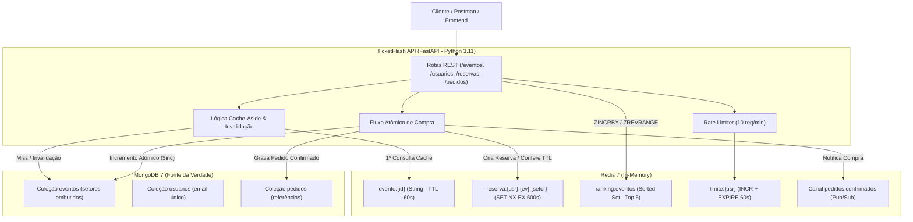
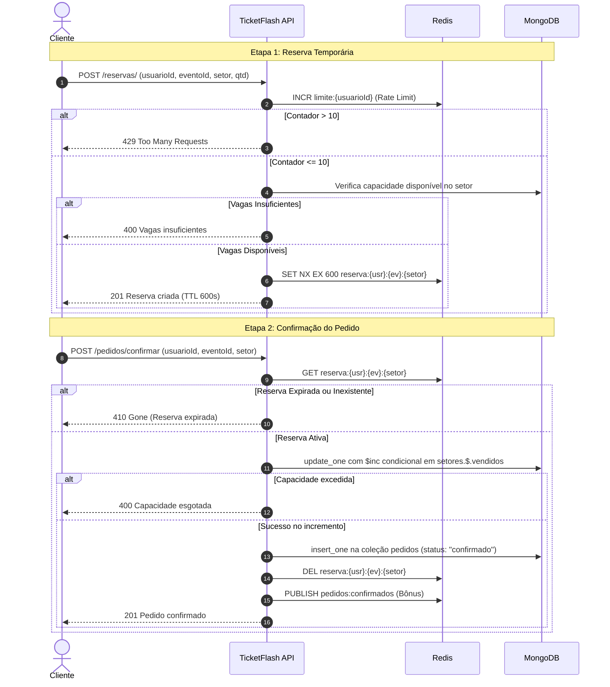

# 🎫 TicketFlash — API REST de Venda de Ingressos

**FIAP — Faculdade de Informática e Administração Paulista**  
**Curso:** Superior de Tecnologia em Análise e Desenvolvimento de Sistemas  
**Disciplina:** Mastering Relational and Non-Relational Database | **Turma:** 2TDSPG  
**Professor:** Vergílio Santos  
**Avaliação:** Checkpoint 3 — Projeto Prático: MongoDB + Redis com Python  

---

## 👥 Integrantes do Grupo

| RM | Nome do Aluno |
| :---: | :--- |
565592 - André Emygdio Ferreira
562194 - Gabriel Lourenço Martins
561336 - Giovane Amato dos Santos
561959 - Matheus Roque Arantes
561584 - Orlando Gonçalves de Arruda 

---

## 📌 Cenário: TicketFlash

A **TicketFlash** é uma plataforma de venda de ingressos para shows e grandes eventos. Em aberturas de vendas de alta demanda, dezenas de milhares de usuários acessam a mesma página simultaneamente, gerando picos extremos de tráfego que sobrecarregam um banco de dados relacional tradicional.

Para resolver esse desafio com alta performance e consistência, a arquitetura divide as responsabilidades entre dois bancos Não-Relacionais:

1. **MongoDB (Fonte da Verdade / Persistência):**
   - Armazena dados duráveis que devem persistir após reinicializações: `eventos`, `usuarios` e `pedidos`.
   - Utiliza documentos flexíveis com subdocumentos e arrays embutidos para acomodar diferentes estruturas de eventos e setores, além de referências entre coleções para evitar duplicações indevidas.
2. **Redis (In-Memory / Velocidade & Estados Temporários):**
   - Atende requisições de milissegundos através do padrão **Cache-Aside** (TTL de 60s).
   - Gerencia reservas temporárias de ingressos com expiração automática (`SET NX EX 600`).
   - Mantém o ranking em tempo real dos eventos mais visualizados usando **Sorted Sets** (`ZINCRBY`).
   - Implementa **Rate Limiting** para controle de abusos (máximo 10 reservas por minuto por usuário via `INCR` + `EXPIRE`).
   - Transmite eventos assíncronos de confirmação de compra via **Pub/Sub** (`pedidos:confirmados`).

---

## 🏛️ Arquitetura da Solução



---

## 🛠️ Tecnologias Utilizadas

- **Linguagem:** Python 3.11+
- **Framework Web:** FastAPI 0.115 + Uvicorn (ASGI assíncrono com documentação Swagger/OpenAPI nativa)
- **Drivers de Banco:**
  - `pymongo 4.8.0` (acesso ao MongoDB)
  - `redis-py 5.0.8` (acesso ao Redis)
- **Validação de Dados:** Pydantic V2
- **Orquestração de Containers:** Docker & Docker Compose v2

---

## 📂 Estrutura do Projeto

```
API-TicketFlash/
├── app/
│   ├── __init__.py
│   ├── main.py                 # Ponto de entrada FastAPI, lifespan e criação dos índices
│   ├── database.py             # Conexões e singletons com MongoDB e Redis
│   ├── models/
│   │   ├── __init__.py
│   │   └── schemas.py          # Schemas Pydantic para validação e serialização
│   └── routes/
│       ├── __init__.py
│       ├── eventos.py          # CRUD de eventos, cache-aside, ranking e agregações
│       ├── usuarios.py         # CRUD de usuários e validação de email único
│       ├── reservas.py         # Reserva temporária (SET NX EX) e Rate Limiting
│       └── pedidos.py          # Confirmação atômica de pedido, 410 Gone e Pub/Sub
├── docker-compose.yml          # Orquestração dos 3 serviços: api, mongo e redis
├── Dockerfile                  # Build otimizado da API Python
├── requirements.txt            # Dependências da aplicação
├── seed.py                     # Script para popular coleções e exibir explain()
├── subscriber.py               # Assinante Pub/Sub (Bônus +0,5)
├── requests.http               # Arquivo com todas as chamadas HTTP prontas para teste
└── README.md                   # Documentação completa do projeto
```

---

## 🚀 Como Executar

### 1. Pré-requisitos
- Ter o **Docker** e o **Docker Desktop** instalados e em execução na máquina.

### 2. Subir o ambiente completo
Dentro da pasta `API-TicketFlash`, execute:

```bash
docker compose up --build
```

Os seguintes serviços subirão automaticamente e ficarão prontos para uso:
- **`api`**: http://localhost:8000
- **`mongo`**: `localhost:27017`
- **`redis`**: `localhost:6379`

> [!TIP]
> A documentação Swagger interativa pode ser acessada em: **http://localhost:8000/docs**

---

### 3. Popular o banco com dados iniciais (Seed)
Abra um novo terminal e execute o script `seed.py` dentro do container da API:

```bash
docker compose exec api python seed.py
```

O script realizará:
1. Limpeza de coleções antigas (`eventos`, `usuarios`, `pedidos`).
2. Inserção de **12 eventos** completos com setores, atrações e locais.
3. Inserção de **22 usuários** com emails únicos.
4. Inserção de **55 pedidos** vinculados aos eventos e usuários.
5. Criação automática dos 3 índices exigidos.
6. Execução e exibição do plano de execução `explain()` comprovando uso de `IXSCAN`.

---

### 4. Executar o Assinante Pub/Sub (Bônus +0,5)
Para visualizar as notificações de pedidos confirmados em tempo real, execute o subscriber em outro terminal:

```bash
docker compose exec api python subscriber.py
```

Sempre que uma compra for finalizada com sucesso via `POST /pedidos/confirmar`, o subscriber capturará a mensagem instantaneamente no canal `pedidos:confirmados`.

---

## 🗄️ Requisito 1 — Modelagem e Justificativas de Decisão

A modelagem de dados foi desenhada respeitando as boas práticas de modelagem em documentos NoSQL, equilibrando performance de leitura, frequência de escrita e integridade referencial:

### 1. Coleção `eventos` (Subdocumentos e Arrays Embutidos)
```json
{
  "_id": ObjectId("6716bcde..."),
  "nome": "Rock in Rio 2025",
  "categoria": "Show",
  "data": "2025-11-20T20:00:00",
  "local": {
    "cidade": "Rio de Janeiro",
    "endereco": "Parque Olímpico da Barra"
  },
  "atracoes": ["Iron Maiden", "Metallica", "Avenged Sevenfold"],
  "setores": [
    {
      "nome": "Pista Premium",
      "preco": 650.0,
      "capacidade": 2000,
      "vendidos": 120
    },
    {
      "nome": "Pista Comum",
      "preco": 350.0,
      "capacidade": 5000,
      "vendidos": 450
    }
  ]
}
```
- **Por que embutir `local`?**
  Um evento ocorre em um endereço físico específico. Não há necessidade de consultar endereços isolados sem o contexto do evento. Embutir evita a penalidade de junções ($lookup) em 100% das leituras.
- **Por que embutir `atracoes`?**
  São atributos descritivos do evento, consultados conjuntamente em consultas de detalhes e listagens.
- **Por que embutir `setores`?**
  Cada evento possui um número restrito e previsível de setores (geralmente entre 2 e 5). Embutir permite que a consulta de detalhes do evento traga a disponibilidade em uma única operação I/O. Além disso, permite operações atômicas de reserva e compra via `$inc` condicional direto no subdocumento sem necessidade de transações distribuídas.

### 2. Coleção `usuarios` (Coleção Independente)
```json
{
  "_id": ObjectId("6716bcda..."),
  "nome": "Carlos Drummond",
  "email": "carlos.drummond@email.com",
  "cidade": "São Paulo",
  "dataCadastro": "2025-02-10T14:30:00"
}
```
- **Justificativa:** Entidade central de autenticação e histórico do cliente. Possui ciclo de vida independente de eventos e pedidos.

### 3. Coleção `pedidos` (Referências)
```json
{
  "_id": ObjectId("6716bce1..."),
  "usuarioId": ObjectId("6716bcda..."),
  "eventoId": ObjectId("6716bcde..."),
  "setor": "Pista Premium",
  "quantidade": 2,
  "valorTotal": 1300.0,
  "status": "confirmado",
  "criadoEm": "2025-03-01T10:15:00"
}
```
- **Por que referenciar em vez de embutir?**
  Um evento ou um usuário pode acumular milhares de pedidos ao longo do tempo (*Unbounded Relationship*). Embutir pedidos dentro de `usuarios` ou de `eventos` violaria o limite de 16MB por documento do MongoDB e provocaria fragmentação de memória e degradação severa nas consultas diárias. O uso de `usuarioId` e `eventoId` indexados permite consultas rápidas e agregações flexíveis via `$lookup`.

---

## 📇 Requisito 3 — Índices e Saída do `explain()`

Foram implementados 3 índices estratégicos:

1. **Índice Único:** `usuarios.email`
   - Garante a integridade de unicidade cadastral e buscas diretas em $O(1)$.
2. **Índice Composto:** `eventos(categoria: 1, data: 1)`
   - Otimiza as buscas frequentes por eventos por categoria ordenados ou filtrados por data.
3. **Índice Simples:** `pedidos.usuarioId`
   - Garante alto desempenho ao listar os pedidos de um cliente específico ou em junções de agregação.

### Saída Real do `explain()` no Índice Composto

Ao executar a busca `db.eventos.find({"categoria": "Show", "data": {"$gte": "2025-01-01"}}).explain()`, o plano de execução confirma a utilização de **`IXSCAN`** (Index Scan), descartando a varredura total de coleção (`COLLSCAN`):

```json
{
  "stage": "FETCH",
  "inputStage": {
    "stage": "IXSCAN",
    "keyPattern": {
      "categoria": 1,
      "data": 1
    },
    "indexName": "categoria_1_data_1",
    "isMultiKey": false,
    "multiKeyPaths": {
      "categoria": [],
      "data": []
    },
    "isUnique": false,
    "isSparse": false,
    "isPartial": false,
    "indexVersion": 2,
    "direction": "forward",
    "indexBounds": {
      "categoria": [
        "[\"Show\", \"Show\"]"
      ],
      "data": [
        "[\"2025-01-01T00:00:00Z\", {})"
      ]
    }
  }
}
```

> [!NOTE]
> **Interpretação do Plano:** O otimizador utilizou o índice `categoria_1_data_1`. A fase `IXSCAN` navegou pela árvore B-Tree apenas no intervalo delimitado por `["Show", "Show"]`, e em seguida a fase `FETCH` recuperou apenas os documentos apontados, provando máxima eficiência.

---

## 📊 Requisito 4 — Agregações MongoDB

Ambos os relatórios foram desenvolvidos utilizando o pipeline nativo de agregação do MongoDB, sem processamento de laços em memória Python:

### 1. Faturamento por Evento (`GET /eventos/relatorios/faturamento`)
- **Pipeline:**
  1. `$match`: Filtra apenas pedidos com `status: "confirmado"`.
  2. `$group`: Agrupa por `eventoId` calculando `faturamento_total: { $sum: "$valorTotal" }`.
  3. `$lookup`: Realiza o cruzamento com a coleção `eventos` via `_id`.
  4. `$unwind`: Desconstrói o array resultante do lookup.
  5. `$project`: Projeta `evento_id`, `evento_nome` e `faturamento_total`.
  6. `$sort`: Ordena de forma decrescente (`faturamento_total: -1`).

### 2. Ocupação por Setor (`GET /eventos/relatorios/ocupacao/{evento_id}`)
- **Pipeline:**
  1. `$match`: Localiza o evento específico por `_id`.
  2. `$unwind`: Expande cada item do array `setores` em um documento independente.
  3. `$project`: Calcula em tempo real o percentual de ocupação via expressão matemática condicional:
     $$\text{percentual} = \text{round}\left(\frac{\text{vendidos}}{\text{capacidade}} \times 100, 2\right)$$

---

## ⚡ Estruturas Redis Utilizadas (Parte 2 e 3)

| Requisito | Funcionalidade | Estrutura Redis | Chave / Comando | TTL / Comportamento |
| :---: | :--- | :--- | :--- | :--- |
| **Req. 5** | Cache de Evento | String (JSON) | `evento:{id}` | `SETEX ... 60` (TTL 60 segundos). Retorna `"origem": "banco"` ou `"origem": "cache"`. |
| **Req. 6** | Reserva Temporária | String (JSON) | `reserva:{usr}:{ev}:{setor}` | `SET NX EX 600` (10 minutos). Bloqueio exclusivo temporário. |
| **Req. 7** | Ranking Mais Vistos | Sorted Set | `ranking:eventos` | `ZINCRBY ranking:eventos 1 {id}` em cada visualização; `ZREVRANGE ... 0 4` para Top 5. |
| **Req. 8** | Rate Limiting | String | `limite:{usuario_id}` | `INCR` + `EXPIRE 60`. Bloqueia com status `429` se contador $> 10$ por minuto. |
| **Req. 9** | Invalidação de Cache | Operação Del | `evento:{id}` | `DEL evento:{id}` executado obrigatoriamente em `PUT` (update) e `DELETE` (delete). |
| **Req. 10** | Fluxo de Compra Atômico | Transacional | `reserva:*` + MongoDB `$inc` | Valida reserva no Redis; se expirou retorna `410 Gone`. Incrementa vendidos via `$elemMatch` condicional. |
| **Bônus** | Notificação Pub/Sub | Mensageria Pub/Sub | Canal `pedidos:confirmados` | Publica JSON com dados da compra para assinantes externos (`subscriber.py`). |

---

## 🔄 Requisito 10 — Fluxo Completo de Compra



---

## 📋 Guia Completo de Endpoints

### 1. Diagnóstico e Status
- **`GET /`**
  - Retorna o status de conexão da API com o MongoDB e com o Redis.

### 2. Eventos
- **`POST /eventos/`**
  - Cria um novo evento no MongoDB.
- **`GET /eventos/`**
  - Lista todos os eventos cadastrados.
  - Suporta filtros via Query Params: `?categoria=Show` ou `?cidade=São Paulo`.
- **`GET /eventos/{id}`**
  - Busca evento por ID aplicando Cache-Aside. Retorna `"origem": "banco"` na primeira chamada e `"origem": "cache"` nas chamadas subsequentes dentro do TTL de 60 segundos. Incrementa o ranking.
- **`PUT /eventos/{id}`**
  - Atualiza campos do evento no MongoDB e invalida a chave no Redis (`DEL evento:{id}`).
- **`DELETE /eventos/{id}`**
  - Remove o evento do MongoDB e invalida a chave no Redis (`DEL evento:{id}`).
- **`GET /eventos/ranking`**
  - Retorna o Top 5 eventos mais visualizados diretamente do Sorted Set do Redis.

### 3. Relatórios / Agregações
- **`GET /eventos/relatorios/faturamento`**
  - Retorna o faturamento total por evento a partir dos pedidos confirmados em ordem decrescente.
- **`GET /eventos/relatorios/ocupacao/{evento_id}`**
  - Retorna a taxa de ocupação percentual de cada setor do evento especificado.

### 4. Usuários
- **`POST /usuarios/`** — Cadastra novo usuário (validação de email único).
- **`GET /usuarios/`** — Lista usuários cadastrados.
- **`GET /usuarios/{id}`** — Busca dados de um usuário por ID.
- **`PUT /usuarios/{id}`** — Atualiza cadastro de usuário.
- **`DELETE /usuarios/{id}`** — Remove cadastro de usuário.

### 5. Reservas e Pedidos
- **`POST /reservas/`**
  - Cria reserva com trava temporária no Redis (`SET NX EX 600`). Valida o limite de 10 requisições por minuto por usuário.
- **`POST /pedidos/confirmar`**
  - Valida a reserva ativa no Redis. Se expirada, responde `410 Gone`. Se válida, incrementa atomicamente o setor, salva o pedido no MongoDB, deleta a reserva e emite notificação Pub/Sub.
- **`GET /pedidos/`** — Lista pedidos registrados.
- **`GET /pedidos/{id}`** — Detalha pedido por ID.

---

## 🎥 Roteiro Passo a Passo para o Vídeo de Apresentação (Até 5 minutos)

Siga rigorosamente estes 7 passos durante a gravação para demonstrar todos os critérios de correção:

| Passo | Duração | Ação a Demonstrar | O que destacar na fala |
| :---: | :---: | :--- | :--- |
| **1** | 0:00 - 0:40 | Executar `docker compose up` e em seguida `docker compose exec api python seed.py`. | Mostrar os 3 containers inicializados (`api`, `mongo`, `redis`) e o script seed populando os dados e mostrando o `IXSCAN` no explain. |
| **2** | 0:41 - 1:20 | Fazer `GET /eventos/{id}` pela 1ª vez (retorna `"origem": "banco"`). Repetir a mesma chamada (retorna `"origem": "cache"`). | Destacar a resposta em milissegundos e a chave criada no Redis com TTL de 60 segundos. |
| **3** | 1:21 - 2:00 | Chamar `PUT /eventos/{id}` alterando o nome do evento. Em seguida, chamar `GET /eventos/{id}` novamente. | Mostrar que a invalidação do cache funcionou (`DEL evento:{id}`) e que a nova leitura buscou os dados atualizados direto do banco (`"origem": "banco"`). |
| **4** | 2:01 - 2:50 | Chamar `POST /reservas/` com um usuário e evento válidos. Mostrar a chave no Redis (`TTL`). Em seguida chamar `POST /pedidos/confirmar`. | Explicar o `SET NX EX 600s`, o `$inc` atômico que incrementou os ingressos vendidos e o pedido gravado no MongoDB. Mostrar a mensagem no console do `subscriber.py` (Bônus). |
| **5** | 2:51 - 3:30 | Tentar chamar `POST /pedidos/confirmar` com dados de uma reserva inexistente ou já expirada. | Mostrar o código de status HTTP retornado: **`410 Gone`**, comprovando que nada foi debitado do banco. |
| **6** | 3:31 - 4:15 | Executar 11 requisições consecutivas de `POST /reservas/` com o mesmo `usuario_id`. | Mostrar que na 11ª chamada a API responde com status **`429 Too Many Requests`** devido ao rate limit no Redis. |
| **7** | 4:16 - 5:00 | Chamar `GET /eventos/ranking` e em seguida os relatórios de agregação (`/faturamento` e `/ocupacao/{id}`). | Mostrar o Top 5 ordenado pelo Redis Sorted Set e os pipelines calculados nativamente pelo motor do MongoDB. |

---

## 📬 Links de Entrega do Grupo

- **Link do Repositório Git Público:** `https://github.com/...`
- **Link do Vídeo Demonstrativo:** `https://youtube.com/...` ou `https://drive.google.com/...`
- **Observações Adicionais:** Todas as dependências e serviços estão pré-configurados para execução limpa via Docker Compose.
